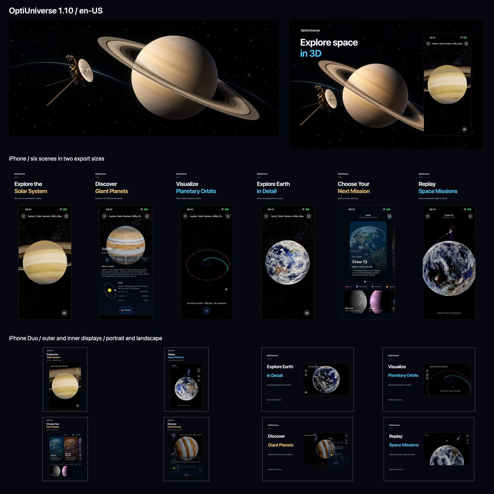

# OptiUniverse 1.10 — App Store package (English US)

Prepared on October 31, 2026. Version **1.10**, build **28**. This local package contains English release metadata and refreshed screenshots. Nothing has been uploaded or submitted to App Store Connect.



## Upload assets

| Placement | Folder or file | Contents |
|---|---|---|
| iPhone, medium Dynamic Island display | [1206 × 2622](screenshots/1206x2622) | Six portrait screenshots, 01–06 |
| iPhone, large Dynamic Island display | [1320 × 2868](screenshots/1320x2868) | The same six scenes, 01–06 |
| iPhone Duo | [Duo screenshots](screenshots/duo) | Eight screenshots across both displays and orientations, 01–08 |
| Product page Header | [Header](creative/header-3840x1646.png) | 3840 × 1646 PNG, reused unchanged from 1.9 |
| Search Results | [Search Results](creative/search-results-3840x2560.png) | 3840 × 2560 PNG, refreshed app foreground |
| English (U.S.) metadata | [Text files](metadata) | Seven UTF-8 files for manual entry in App Store Connect |

All upload PNGs are opaque 8-bit RGB in sRGB. The overview and files under `sources` are for review and regeneration, not direct upload.

## Upload instructions

1. Open the iOS **1.10** version in App Store Connect and select **English (U.S.)**.
2. Open **App Previews and Screenshots → View All Sizes in Media Manager**. Upload each ordinary iPhone set to its matching display-size slot in filename order. These are alternative size sets, not twelve screenshots in one slot.
3. In the **iPhone Duo** slot, upload all eight files from the four Duo size folders, in order 01–08. The eight files form one set; folder names describe the captured display and orientation.
4. Assign the dedicated Header and Search Results files to their respective placements.
5. Fill the fields below, save, and review the placements using App Store Connect Preview. Final upload acceptance and submission remain manual.

| File in `metadata` | Field | Characters / limit |
|---|---|---|
| `description.txt` | Description | 1958 / 4000 |
| `promotional_text.txt` | Promotional Text | 159 / 170 |
| `keywords.txt` | Keywords | 91 / 100 |
| `release_notes.txt` | What's New in This Version | 595 / 4000 |
| `marketing_url.txt` | Marketing URL | Existing URL |
| `support_url.txt` | Support URL | Existing URL |
| `privacy_url.txt` | Privacy Policy URL | Existing URL |

Counts exclude the final newline. App name and account-level settings retain their existing values.

## Screenshot sequence

The ordinary iPhone sequence is Saturn, Jupiter details, Earth–Jupiter transfer preview, Earth, discovery, and Crew 13 replay.

| Duo order | Display / orientation | Pixels | Scene |
|---|---|---|---|
| 01 | Outer portrait | 1398 × 2034 | Saturn |
| 02 | Outer portrait | 1398 × 2034 | Crew 13 replay |
| 03 | Outer landscape | 2034 × 1398 | Earth |
| 04 | Outer landscape | 2034 × 1398 | Earth–Jupiter transfer preview |
| 05 | Inner portrait | 2007 × 2853 | Discovery with expanded mission cards |
| 06 | Inner portrait | 2007 × 2853 | Jupiter details in a bottom panel |
| 07 | Inner landscape | 2853 × 2007 | Jupiter details in a side panel |
| 08 | Inner landscape | 2853 × 2007 | Crew 13 replay |

## Provenance and regeneration

Captures come from newly built OptiUniverse **1.10 (28)**, built with Xcode 27.1 (27A9275) and the iOS 27.1 SDK from the current checkout. Devices: iPhone 17 / iOS 27.0 and iPhone Duo / iOS 27.1. Both use English US, dark appearance, and a 09:41 status-bar override. The installed app code library on both devices matches the built product by SHA-256; the hash is recorded in the manifest. Native system UI varies with display and orientation.

- `sources/captures`: fourteen original, unretouched Simulator PNGs. Each device pose is captured natively; Duo layouts are not enlarged ordinary iPhone captures.
- `sources/compose.swift`: AppKit composition source. It preserves each full capture's aspect ratio and places English promotional text outside the app viewport.
- `sources/artwork`: unchanged backgrounds from 1.9 and their original prompts. No app UI was generated or repainted.
- `manifest.json`: dimensions, SHA-256 hashes, app version, device, display, and orientation.
- [VALIDATION.md](VALIDATION.md): validation results and outstanding limitations.

Run from the repository root on macOS. The compositor copies the approved Header from the preserved 1.9 package:

```sh
swift AppStore/1.10/en-US/sources/compose.swift
python3 AppStore/1.10/en-US/sources/validate.py --write-manifest
python3 AppStore/1.10/en-US/sources/validate.py
```

For a restricted Swift module cache, add `-module-cache-path` pointing to a writable temporary directory after `swift`. Recomposition uses the saved captures; recapturing a live simulation can produce different planet orientations and mission progress.

To recapture, build and install the current version, launch with `-AppleLanguages '(en)' -AppleLocale en_US`, select the intended scene through the app, and use `xcrun simctl io DEVICE screenshot OUTPUT.png`. On Duo, pass `--display=1` for the outer display or `--display=3` for the inner display, confirming IDs with `xcrun simctl io DEVICE enumerate`. Change display pose and orientation in Device Hub; verify dimensions before replacing a saved capture. Configure the 09:41 override with `simctl status_bar` and dark appearance with `simctl ui`.

Mission replays are compressed illustrative visualizations, not live spacecraft tracking. The screenshots preserve actual app content, including native viewport clipping of large planets or orbital paths.

Specifications checked on October 31, 2026: [screenshots](https://developer.apple.com/help/app-store-connect/reference/app-information/screenshot-specifications), [iPhone Duo preparation](https://developer.apple.com/iphone-duo/prepare/), and [asset management](https://developer.apple.com/help/app-store-connect/manage-app-information/manage-your-app-store-assets/).
