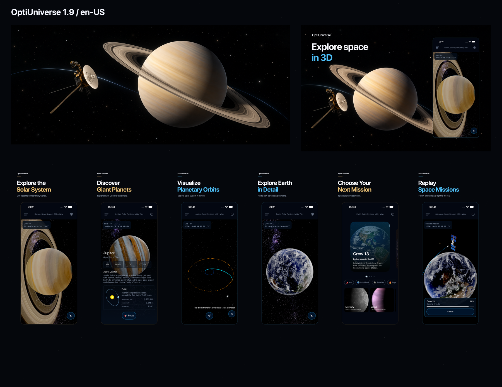

# OptiUniverse 1.9 — App Store package (English US)

Prepared on October 16, 2026. Version **1.9**, build **26**. This is a local release-assets package; nothing has been uploaded or submitted to App Store Connect.



## Files to upload

| Placement | File / folder | Format |
|---|---|---|
| Product page Header | [header-3840x1646.png](creative/header-3840x1646.png) | 3840 × 1646 PNG, no text |
| Search Results | [search-results-3840x2560.png](creative/search-results-3840x2560.png) | 3840 × 2560 PNG, “Explore space in 3D” |
| iPhone with Dynamic Island, large display | [screenshots/1320x2868](screenshots/1320x2868) | Six portrait PNGs |
| iPhone with Dynamic Island, medium display | [screenshots/1206x2622](screenshots/1206x2622) | Six portrait PNGs |
| English US text fields | [metadata](metadata) | UTF-8 text files |

All upload PNGs are opaque RGB and tagged sRGB. Upload each screenshot size to its own device slot; the two sizes represent the same six screenshots.

## Upload order

1. Open OptiUniverse's iOS version 1.9 in App Store Connect and select **English (U.S.)**.
2. In **Product Page Information → App Previews and Screenshots**, use **View All Sizes in Media Manager** to place each screenshot set in the matching device slot. Keep filenames in ascending order, **01 through 06**.
3. In **Header and Search Results**, assign the two dedicated creative files to their respective placements and save. These are separate assets, rather than one universal image.
4. Fill the text fields using the mapping below. Review both placements with App Store Connect's **Preview** tool before submitting the version yourself.

These steps follow Apple's [asset-management guide](https://developer.apple.com/help/app-store-connect/manage-app-information/manage-your-app-store-assets/). Creative placements are available on iOS 27 and later; keep the screenshot sets for the product page and other supported OS versions.

| Text file | App Store Connect field | Characters / limit |
|---|---|---|
| `metadata/description.txt` | Description | 1525 / 4000 |
| `metadata/promotional_text.txt` | Promotional Text | 151 / 170 |
| `metadata/keywords.txt` | Keywords | 97 / 100 |
| `metadata/release_notes.txt` | What's New in This Version | 635 / 4000 |
| `metadata/marketing_url.txt` | Marketing URL | Existing URL |
| `metadata/support_url.txt` | Support URL | Existing URL |
| `metadata/privacy_url.txt` | Privacy Policy URL, in App Privacy | Existing URL |

The text copies match `fastlane/metadata/en-US`. Counts exclude the final newline. App name and other account-level settings retain their current values.

## Screenshot sequence and provenance

| Order | Filename | Actual app content |
|---|---|---|
| 01 | `01-saturn.png` | Saturn close-up with its rings |
| 02 | `02-jupiter.png` | Jupiter with facts, description, and orbital information |
| 03 | `03-orbits.png` | Earth–Jupiter transfer preview with planetary orbital paths |
| 04 | `04-earth.png` | Earth close-up |
| 05 | `05-home.png` | Current home screen: Crew 13 first, mission carousel, filters, destination cards |
| 06 | `06-crew13.png` | Crew 13 replay near ISS, with Earth, trajectory, and docking progress |

The six captures came from the already-installed **1.9 (26)** app on **iPhone 17 / iOS 27.0**, using English US and a 09:41 status bar. No new app build was run. The saved captures show the available installed build; its executable was not rebuilt from the current Git checkout.

Each complete capture is preserved at its original aspect ratio inside the new layout. The existing Saturn close-up intentionally extends its rings beyond the app viewport; the release layout introduces no further crop. The actual mission UI displays “Unknown” as the top location during replay. The package preserves that shipped UI rather than editing its text.

The supplied old home image, `1290x2796bb-5.png`, is retained only in `sources/attachments`. Screenshot **05** in both upload folders uses the new home capture. No old attachment is intended for direct upload.

The mission copy describes compressed illustrative replays. It makes no claim of live spacecraft telemetry or live cloud updates. What's New was checked against Git history after the 1.8 version commit `e0354c34`; existing Starship content remains in the general description rather than being announced as new in 1.9.

## Sources and regeneration

- `sources/attachments`: all six original user attachments, unchanged.
- `sources/captures`: six unmodified Simulator screenshots.
- `sources/artwork`: selected generated artwork and [exact prompts](sources/artwork/prompts.md). The built-in imagegen tool created two advertising backgrounds; app UI and the foreground app render were preserved from real captures.
- `sources/compose.swift`: native AppKit layout source for both creative placements, screenshots, and the overview.
- [manifest.json](manifest.json): export dimensions, SHA-256 hashes, and capture provenance.
- [VALIDATION.md](VALIDATION.md): local asset checks and validation boundaries.

From the repository root, regenerate the layouts with:

```sh
swift AppStore/1.9/en-US/sources/compose.swift
```

The Header source is `sources/artwork/header-generated.png`. Its native 1916 × 821 artwork was resized to the required 3840 × 1646 and tagged sRGB. The Search background's native resolution is 1536 × 1024; the saved composition exports at 3840 × 2560. Original generated files are retained for future revisions.

Specifications checked on October 16, 2026: [creative assets](https://developer.apple.com/help/app-store-connect/reference/app-information/creative-assets-specifications), [screenshots](https://developer.apple.com/help/app-store-connect/reference/app-information/screenshot-specifications), and [design guidance](https://developer.apple.com/app-store/asset-best-practices/).

Per the task instructions, app builds, app tests, and SwiftLint were excluded from implementation. Final App Store Connect preview, asset acceptance, and review remain pending upload.
